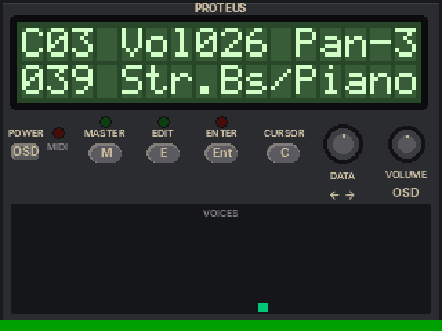

# E-mu Proteus/1 XR for MiSTer

A MiSTer FPGA core of the E-mu Proteus/1 XR sound module (1989–90). It runs the original firmware
on a 68000 with HDL models of the MC68901 MFP, the HD44780 LCD and the Proteus/1 sound chip
(32 voices, 39.0625 kHz). Play it from a MIDI keyboard; use the front panel from the MiSTer
keyboard or a joystick. No ROMs are included: you build the core's system image from files you
download yourself.



The MiSTer screen: the front panel with the LCD, the MIDI / MASTER / EDIT / ENTER LEDs, the buttons
with their keyboard keys, and a level bar for each of the 32 voices.

## Source

The source, the tests and the design notes are in
[gmcnaught/synthcores](https://github.com/gmcnaught/synthcores) under
[`cores/proteus/`](https://github.com/gmcnaught/synthcores/tree/main/cores/proteus). Each release
names the commit it was built from. This repository keeps only the releases, the image tool and
this README; its history before the move still holds the source up to v0.2.0.

## Installing

You need three files on the MiSTer's SD card: the core, the MGL that starts it, and a system image
that you build from your own downloads.

```
SD card
├── Proteus.mgl                  starts the core with the system image, from releases/
├── _Devices/
│   └── Proteus_YYYYMMDD.rbf     the core, from releases/
└── games/
    └── Proteus/
        └── proteus_system.bin   the system image you build in step 2
```

### 1. Download the source files

No ROMs are included. Download these three zip files and keep them as they are (don't unzip them):

| File | Where to get it | What it holds |
|---|---|---|
| `Proteus 1 XR w Protologic - v2.30.zip` | the dbwbp.com synth EPROM archive (also on proteus.nekoweb.org) | firmware v2.30 and the ProtoLogic sound ROMs |
| `poprockroms.zip` | proteus.nekoweb.org, "Proteus/1 Waverom Dump" | the Proteus/1 sound ROMs |
| `hd44780.zip` | a MAME ROM set | the LCD's character set |

The file names don't matter; the tool checks every ROM inside the zips by its SHA-1 hash.

### 2. Build the system image

On a PC with Python 3.8 or newer (no extra packages; on Windows, type `py` for `python3`):

```bash
git clone https://github.com/gmcnaught/emu-proteus-xr-MiSTer
cd emu-proteus-xr-MiSTer
python3 tools/build_image.py \
    --protologic "Proteus 1 XR w Protologic - v2.30.zip" \
    --waverom poprockroms.zip \
    --font hd44780.zip \
    -o proteus_system.bin
```

- On success it prints `proteus_system.bin: 8593408 bytes; Proteus/1 bank: ROM dump`.
- If a ROM in a zip is not the expected dump, or is missing, it stops with an error that names
  the file.
- No `poprockroms.zip`? Use `--samples "Proteus 1.zip"` (archive.org, `e-mu-sample-sets`) in place
  of `--waverom`. It rebuilds the sound ROM from E-mu's Emulator X conversion, but only
  approximately: 29 sounds are silent and others are wrong or at a different level.

### 3. Copy the files to the SD card

1. Make the folder `games/Proteus/` and copy `proteus_system.bin` into it.
2. Copy the newest `Proteus_YYYYMMDD.rbf` from [`releases/`](releases/) to `_Devices/`.
3. Copy [`releases/Proteus.mgl`](releases/Proteus.mgl) to the top of the SD card.
4. Start **Proteus** from the MiSTer main menu. The MGL loads the core and the system image
   together.

If you start the RBF directly instead, open the OSD (F12) and choose **Load System** →
`proteus_system.bin`.

**First start:** the core loads the factory presets by running the firmware's own *Initialize*
(about 9 seconds; the LCD shows the steps), restarts, and saves the presets to
`saves/Proteus/proteus_system.sav`. Later starts load that file, so your edits are kept.

### 4. Connect MIDI

The core plays the MIDI that arrives on the MiSTer's UART through MidiLink.

1. Plug a USB MIDI interface or a USB MIDI keyboard into the MiSTer.
2. Start the core, open the OSD (F12) and press Right to reach the **System** page.
3. Open **UART mode**, set **Connection** to **MIDI** and **MidiLink** to **USB**. Main_MiSTer
   saves this per core.
4. Play. Notes, program changes, CC7 (volume) and CC10 (pan) are tested. The Proteus/1's other MIDI
   features (multitimbral setups, assignable controllers, SysEx) come from the original firmware
   and are not yet checked on the core.

## Controls

| Front panel | Keyboard | Joystick |
|---|---|---|
| MASTER | M | button 1 |
| EDIT | E | button 2 |
| CURSOR | C or Tab | button 3 |
| ENTER | Enter | button 4 |
| Data knob −1 / +1 | Left, Down, `-` / Right, Up, `=` | left, down / right, up |

OSD options:

| Option | What it does |
|---|---|
| Volume | the front-panel volume knob |
| Output Level | extra gain, 0 dB by default (the MiSTer volume boost also works) |
| Tone Filter | On by default; Off uses one interpolation filter for every voice (see Known limits) |
| Save Presets | saves the presets now |
| Autosave on OSD open | On by default: saves the presets each time you open the OSD |
| Factory Reset Presets | runs *Initialize* again; your presets are overwritten at the next save |

## Known limits

- The sound chip is modelled from the firmware's use of it and from E-mu's patents of the period:
  7-point interpolation with the patent's printed filter. The envelope slew rate and the pan law
  are inferred; nothing has been compared with recordings of a real unit.
- Tone: the "Dark" instruments, and notes played above a sample's root, use filters with lower
  cutoffs whose exact values are not published. Tones 1–5 are designed to match the published one.
  **Tone Filter** Off uses the published filter for every voice.
- Only the XR v2.30 firmware with the ProtoLogic expansion is supported.

## License

GPL-3.0-or-later; see [`LICENSE`](LICENSE) and [`NOTICE.md`](NOTICE.md) (fx68k by Jorge Cwik, the
MiSTer framework, the MAME patch under BSD-3-Clause). E-mu, Proteus and ProtoLogic are trademarks of
their owners; this project is not affiliated with them.
